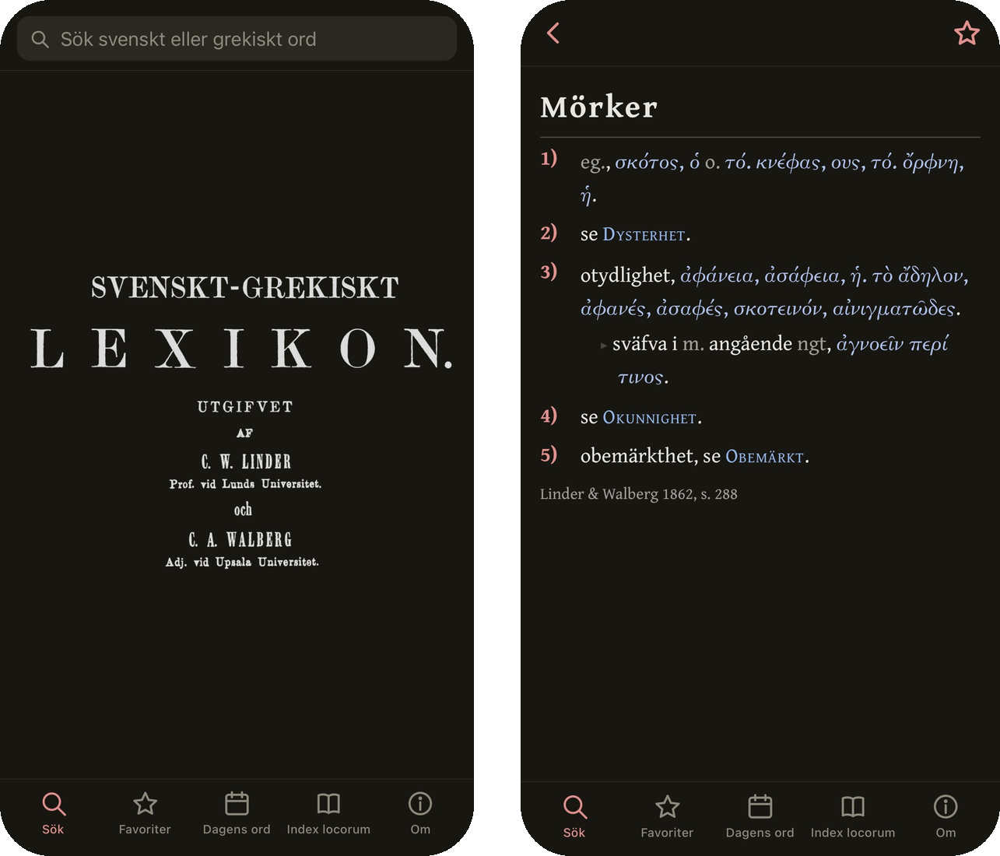
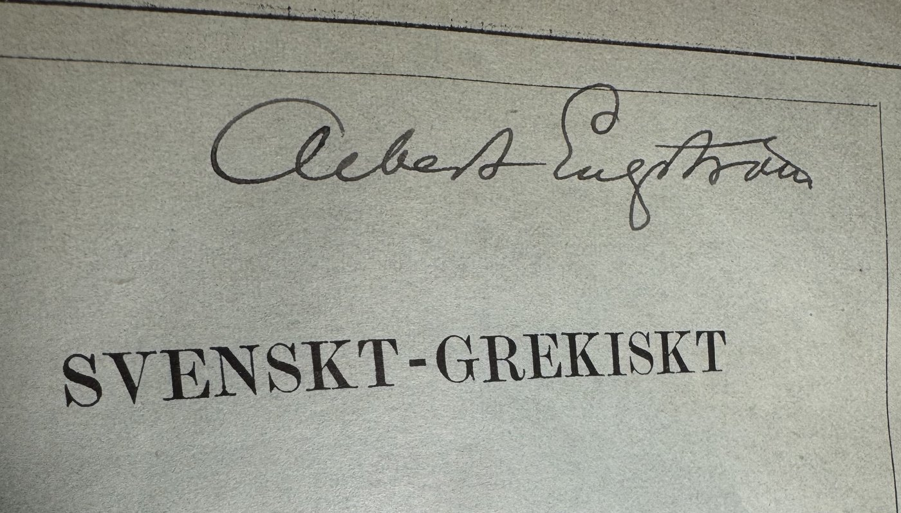

<p align="center">
  
</p>

# Linder och Walberg: _Svenskt-grekiskt lexikon_

> _Nyttan, eller rättare nödvändigheten, af Grekiska Skriföfningar har under de sednare åren äfven hos oss blifvit allmänt insedd och erkänd._
>
> — C. W. Linder och C. A. Walberg, *Förord*, 1862

Carl Wilhelm Linder och Carl August Walbergs klassiska skrivövningslexikon från 1862 skannades in av Johan Winge 2013 och lades till på Projekt Runeberg, men OCR-teknologin var då långt från redo för 
textens utmanande blandning av polytonisk grekiska, gammelstavad svenska och idiosynkratiska förkortningar, 
och i princip bara de tjugosextusen huvudorden gjordes maskinläsbara och alltså sökbara. 
På tretton år korrlästes bara de första fem sidorna på Projekt Runeberg.

Två huvudsakliga tekniska framsteg gjorde det möjligt att relativt enkelt för en person att genomföra en komplett OCR och korrläsning av hela texten år 2026. För det första så har det kommit öppna OCR-modeller som är finetunade för antik grekiska ([Angleraud et al 2026](https://arxiv.org/abs/2603.02803)), och för det andra så kan man förhållandevis snabbt dubbelkolla den öppna modellens resulterande OCR-text från alla 536 sidor mot källbilderna med en svärm av Claude-agenter.

Ordboken tillgängliggörs härmed i ett antal olika format. För det första så kan den som använder Macbook integrera denna nya Linder-Walberg i Mac OS' inbyggda ordbok (för Linux/PC finns motsvarande alternativ), genom att ladda ner rätt fil i "Releases" i denna repository. För det andra så finns det en [webb app](https://albinthorncleland.com/linder-walberg/) som rekommenderas för mobilanvändare, och som är skräddarsydd för att sparas som en app på hemskärmen på iPhone.

För den som är intresserad av att fortsätta förbättra OCR-modeller för antik grekiska så tillgängliggörs bilder och alignad text på [Hugging Face](https://huggingface.co/datasets/Urdatorn/linder-walberg). 

## Fördelar med denna utgåva

- Stavningen från 1862 behålls (*hvar*, *af*, *qvinna*), men sökningen **hittar även moderna stavningar**.
- **Baklängessökning** på grekiska termer ger svenska lemma som innehåller dem.
- Bokens **förkortningar förklaras** där de förekommer, även de som inte inkluderas i dess egen förteckning på s. 540.
- De av Linder och Walbergs exempelfraser som förekommer i klassiska källtexter har samlats i en _index locorum_. 

## Mitt exemplar

<p align="center">
  
</p>

<!-- Text om exemplaret -->

## Så gjordes utgåvan

| steg | var | |
|---|---|---|
| OCR | [`ocr/`](ocr/) | Varje sida delades upp i remsor som lästes av en vision-language-modell finetunad för grekiskt och latinskt tryck ([CLLG/Qwen3VL-8B-synth_real](https://huggingface.co/CLLG/Qwen3VL-8B-synth_real)). Avkodningen begränsades så att svenska uppslagsord inte kan komma ut med grekiska bokstäver. |
| tvätt | [`ocr/clean.py`](ocr/clean.py) | Alignment på ordnivå mot Runebergs OCR från 2013, för att fastställa svenskan |
| korrekturläsning | [`proof/`](proof/) | Alla 540 sidor korrekturlästa remsa för remsa av språkmodellsagenter (Claude), som var och en jämförde texten med sidbilden |
| grekiskan | [`ocr/greek_checks.py`](ocr/greek_checks.py), [`corrections/`](corrections/) | Kontroll av spiritus, accenter och deras placering, gravis före följande ord, enklitika, samt att varje form är belagd i ett lexikon med 6,5 miljoner former och i LSJ |
| rättelser | [`ocr/apply_corrections.py`](ocr/apply_corrections.py) | Varje rättelse prövades i sitt sammanhang och avvisades om den skapade ett problem någon annanstans |
| Index locorum | [`locorum/`](locorum/) | De grekiska citaten spårades till sina källor genom sökning i texterna från Perseus och First1KGreek. De anförs med LSJ:s namn och förkortningar, och ett citat räknas bara om det innehåller minst två substantiv eller verb, enligt taggningen från [Stoicheia](https://huggingface.co/Ericu950/Stoicheia-tagger-parser). Sammanlagt 77 författare. |
| utgåvor | [`dict/`](dict/), [`app/`](app/), [`hf/`](hf/) | Dictionary.app, StarDict, MDict, webbappen och datasetet, alla byggda från `text/corrected` |

De två författarna har egna artiklar, hämtade ur *Svenskt biografiskt handlexikon* (1906), med
sina porträtt.

## Building

```sh
python dict/build_xml.py           # the Dictionary.app source; then `make install` in dict/src on a Mac
python dict/build_other.py         # StarDict and MDict
app/deploy.sh                      # build the web app and publish it (GitHub Pages, branch gh-pages)
python hf/build_dataset.py         # the Hugging Face dataset
```

## Acknowledgments

Computational resources were provided by the National Academic Infrastructure for Supercomputing in Sweden (NAISS), funded by the Swedish Research Council.

The _Index locorum_ was built referencing texts from the Perseus Digital Library and First1KGreek.
The font GFS Porson is due to The Greek Font Society; Gentium Book Plus to SIL.

## Licence

The book is in the public domain. The transcription and corrections are released under
[CC0](https://creativecommons.org/publicdomain/zero/1.0/).

This digital edition is a project by [Albin Thörn Cleland](https://albinthorncleland.com), doctoral student in the Swedish Graduate School of Digital Philology at [Lund University](https://www.sol.lu.se/person/AlbinThornCleland/).
